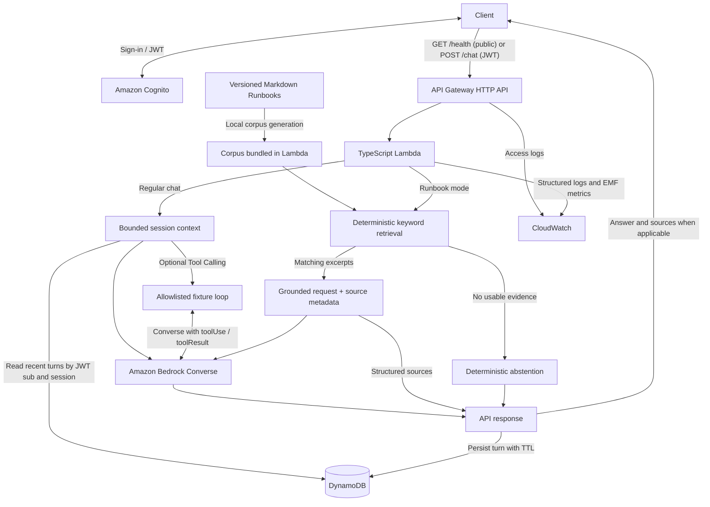

# Authenticated Bedrock Chat Backend

[](https://github.com/hongzz0618/aws-bedrock-chat-backend/actions/workflows/ci.yml)

A serverless TypeScript API for persistent chat and Runbook-based troubleshooting on AWS. The engineering problem is how to give a model useful context while keeping each user's conversation private and bounding the work each request can trigger.

- **Chat.** API Gateway validates Cognito JWTs. Lambda uses the authenticated `sub` and session ID to load recent conversation turns from DynamoDB, calls Amazon Bedrock Converse, and saves the completed turn with a TTL.
- **Runbook RAG.** Lambda retrieves excerpts from a small, versioned corpus of AWS troubleshooting Runbooks. The response includes structured references to the excerpts sent to Bedrock. When no evidence fits, Lambda returns a fixed abstention without calling the model.
- **Simulated Tool Calling.** Regular chat can opt into a bounded Converse loop for two allowlisted tools. `get_sqs_queue_status` and `get_lambda_function_status` use synthetic fixtures for `orders-demo` and `chat-demo`. The backend labels fixture-based answers as simulated.

## Architecture



## Engineering decisions

| Decision | Reason and trade-off |
| --- | --- |
| Identity comes from the JWT `sub` | The DynamoDB partition key is the authenticated user. An encoded session prefix keeps sessions separate within that partition. Clients can reuse the same session ID across accounts. |
| Bounded context and retention | Chat sends recent whole turns within a character budget. Runbook mode skips history and tools, with up to 3 whole excerpts, 3,000 evidence characters and 12,000 model-input characters. TTL removes old turns asynchronously. |
| Bundled keyword retrieval | Three curated English Runbooks cover SQS backlog, Lambda failures and retry/DLQ recovery. Retrieval is reproducible and requires no indexing service. Updates need a rebuild and deployment, and unfamiliar paraphrases can miss. |
| Separate feature flags | Terraform keeps `rag_enabled` and `tool_calling_enabled` off by default. Each feature can be evaluated or rolled back independently. |
| Bounded model and failure paths | Lambda validates requests, scopes IAM to the configured Bedrock resources and history table, and caps the tool loop at three Converse calls. Invalid inputs fail before model work. Responses use sanitized errors and a failed request does not write a partial turn. |

See the [architecture decisions](docs/adr/) and the [OpenAPI contract](openapi/openapi.yaml).

## Observability and cost

CloudWatch receives API access logs and structured Lambda logs. Application EMF metrics cover requests, failures, latency, token usage and tool activity. Logs omit JWTs, prompts, conversation history and model/tool output. Terraform keeps the existing budget alerts and applies configurable, best-effort dev stage throttling, with a default target of 2 requests per second and a burst of 5. Budget notifications and throttling provide visibility and traffic control. Neither enforces a hard spending cap. [AWS HTTP API throttling](https://docs.aws.amazon.com/apigateway/latest/developerguide/http-api-throttling.html), [AWS Budgets](https://docs.aws.amazon.com/cost-management/latest/userguide/budgets-managing-costs.html)

## Validation status

| Evidence | What it covers |
| --- | --- |
| [Offline tests and RAG evaluation](docs/rag-phase1-evaluation.md) | The fixed 24-question retrieval benchmark passed all 24 cases, including six abstentions. Additional probes found one retry/DLQ paraphrase miss. Mocked tests cover grounding request construction, no-call abstention, tool execution and failure paths. |
| [Earlier AWS validation](docs/deployment-validation.md) | A temporary dev deployment verified public health, JWT rejection, authenticated text chat, DynamoDB persistence and CloudWatch delivery. The environment was torn down. |
| [Controlled AWS validation checklist](docs/aws-integration-verification-checklist.md) | Live RAG grounding, simulated tool use with the real model, current deployment settings and the new throttling configuration await validation. |

## Local verification

Use Node.js 22 and Terraform 1.9.8 to match [CI](.github/workflows/ci.yml). These checks run without AWS credentials. Dependency installation, the npm audit and Terraform provider initialization may need access to public registries.

```bash
npm ci
npm run typecheck
npm test
npm run contract:validate
npm run test:contract
npm run build
npm audit --omit=dev
bash scripts/package_lambda.sh
npm run artifacts:verify
terraform fmt -check -recursive
terraform -chdir=live/dev init -backend=false -input=false
terraform -chdir=live/dev validate
terraform -chdir=live/dev test
npm run runbooks:demo
node scripts/smoke_aws.mjs baseline --dry-run
```

To update the corpus, edit [the Markdown Runbooks](docs/runbooks/), keep document and chunk IDs stable, bump the version when guidance or retrieval metadata changes, and run `npm run runbooks:generate`. Review the generated corpus together with the Markdown changes. The demo shows selected excerpts and abstention offline.

## Scope and deployment

This backend uses a curated corpus and simulated telemetry. Structured sources identify the excerpts supplied to the model. Claim-level grounding and prompt-injection resistance still require the live evaluation. Vector search, runtime ingestion, streaming, a frontend and real AWS telemetry tools are deferred.

Use the [dev Terraform root](live/dev/), [example settings](live/dev/terraform.tfvars.example) and [AWS validation and cleanup checklist](docs/aws-integration-verification-checklist.md) for the next approved deployment.
