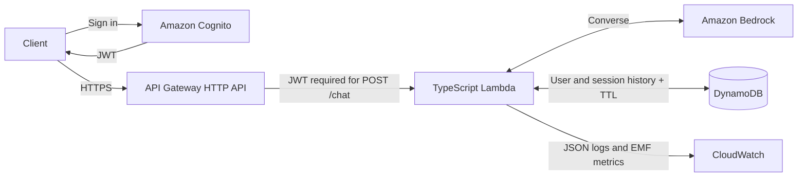

# Authenticated Bedrock Chat Backend

[](https://github.com/hongzz0618/aws-bedrock-chat-backend/actions/workflows/ci.yml)

## Project Overview

A TypeScript serverless chat API that connects authenticated users to Amazon
Bedrock Converse and keeps each user's conversation history isolated. It
demonstrates how to build an AI backend with bounded requests, persistent
sessions, and operational telemetry on AWS.

## Key Features

- **Authentication and isolation.** API Gateway validates Cognito JWTs for
  chat. Lambda derives user identity from the authenticated JWT `sub` claim.
  DynamoDB history is scoped to that user and session, so users can reuse the
  same session ID without sharing history.
  Clients cannot supply their own user identity or choose the model.
- **Bounded conversations.** Lambda validates request fields, selects recent
  complete turns within a character budget, and stores the prompt and final
  answer with a DynamoDB TTL.
- **Bedrock Tool Calling.** An optional, bounded Converse loop validates model
  requests and runs two allowlisted, simulated tools.
- **Operations.** CloudWatch receives structured logs and EMF metrics for
  requests, failures, latency, and token usage. Lambda logs omit JWTs, prompts,
  chat history, and raw tool results. Terraform defines the dev infrastructure.

## Architecture



For chat, Lambda loads bounded history before calling Bedrock and writes a turn
after it receives a non-empty final answer. The
[session isolation ADR](docs/adr/001-authenticated-session-isolation.md) and
[context and retention ADR](docs/adr/002-bounded-context-and-retention.md)
explain the storage and context decisions.

## API & Tool Calling

| Endpoint | Access | Purpose |
| --- | --- | --- |
| `GET /health` | Public | Liveness check |
| `POST /chat` | Cognito bearer JWT | Send a prompt and optionally reuse a session |

For an approved deployment, set `API_URL` and `JWT` in your shell before using
this example:

```bash
curl -X POST "${API_URL}/chat" \
  -H "Authorization: Bearer ${JWT}" \
  -H "Content-Type: application/json" \
  -d '{"session_id":"demo-session","prompt":"Give a short greeting."}'
```

A successful response includes the session ID, answer, and usage metadata.
See [OpenAPI](openapi/openapi.yaml) for request limits and error responses.

### Simulated tools

| Tool | Fixture data |
| --- | --- |
| `get_sqs_queue_status` | Queue counts for `orders-demo` |
| `get_lambda_function_status` | Function metrics for `chat-demo` |

When enabled, Lambda sends tool definitions to Bedrock, validates any
`toolUse` request, and returns a matching `toolResult` before asking Bedrock
for the final answer. The loop bounds calls, rounds, requests, execution time,
payload sizes, and generated tokens. DynamoDB stores the original prompt and
final answer as conversation content.

Both tools are read-only and use deterministic fixtures. They make no live
SQS, Lambda, or CloudWatch queries. The backend labels answers that use fixture
data as simulated. The server-side `TOOL_CALLING_ENABLED` flag defaults to
`false`. Terraform-managed activation is deferred.

## Testing & Validation

- **Local and CI.** Vitest covers chat behavior, session isolation, the API
  contract, and [mocked Tool Calling](tests/toolConversation.test.ts).
  [CI](.github/workflows/ci.yml) also checks the Lambda build and package and
  runs Terraform plan tests with a mocked AWS provider.
- **Prior live AWS validation.** A temporary dev deployment in `eu-west-1`
  verified the earlier text-only chat path, including Cognito authorization,
  Bedrock invocation, DynamoDB history and TTL metadata, and CloudWatch
  telemetry. The environment was torn down after validation. The
  [validation report](docs/deployment-validation.md) preserves the results and
  sanitized screenshots.
- **Live Tool Calling remains unverified.** The
  [AWS integration checklist](docs/aws-integration-verification-checklist.md)
  describes a future controlled validation session.

## Local Development

Use Node.js 22 to match CI. These checks run without AWS credentials:

```bash
npm ci
npm run typecheck
npm test
npm run contract:validate
npm run build
```

See the [CI workflow](.github/workflows/ci.yml) for the Lambda packaging and
Terraform checks.

## Documentation & Limitations

- [Architecture decisions](docs/adr/) cover session isolation, bounded context,
  retention, and Bedrock sampling compatibility.
- [Dev infrastructure](live/dev/) contains the Terraform configuration.
- [AWS validation evidence](docs/evidence/) contains the earlier text-only
  deployment screenshots.

RAG Phase 1 uses three bundled Runbooks (SQS backlog, Lambda failures, retry/DLQ
recovery) with deterministic English keyword retrieval; no embeddings or live telemetry.
Runbook guidance is available with `RAG_ENABLED=true` (disabled by default) and
`POST /chat` with `{"mode":"runbook","prompt":"How do I investigate Lambda throttling?"}`.
Runbook requests reject `system_prompt` and `history_turns`, skip history and tools,
and use at most 3 complete excerpts, 3000 evidence-text characters and 12000 total
model-input characters including instructions and source labels (UTF-16 code units).
Responses include `sources` with document/chunk IDs, title, section and version for
the excerpts actually supplied, not independent verification of every answer claim.
No match returns a deterministic abstention with `sources: []`, `usage: {}` and no
`stopReason` or model call. Answers and abstentions are saved to the JWT user's
session; later regular chat in that session can read them. Omitting `mode` retains
regular chat behavior. Retrieval is English keyword based; mocked tests do not
establish model grounding quality or prompt-injection resistance.

Terraform exposes `rag_enabled` in `live/dev` (boolean, default `false`) as the
string environment variable `RAG_ENABLED`. Set `rag_enabled = true` only for a
future approved deployment; changing a local tfvars file alone does not activate it.
See [offline evaluation and live checklist](docs/rag-phase1-evaluation.md) for
measured results, the remaining retry/DLQ paraphrase miss, and approval requirements.
Model-written citations in response text are not validated by the server.

This is a backend reference. Streaming and a frontend are outside the
current implementation. DynamoDB TTL deletion is asynchronous, and budget
alerts and request limits do not enforce a hard spending cap.
